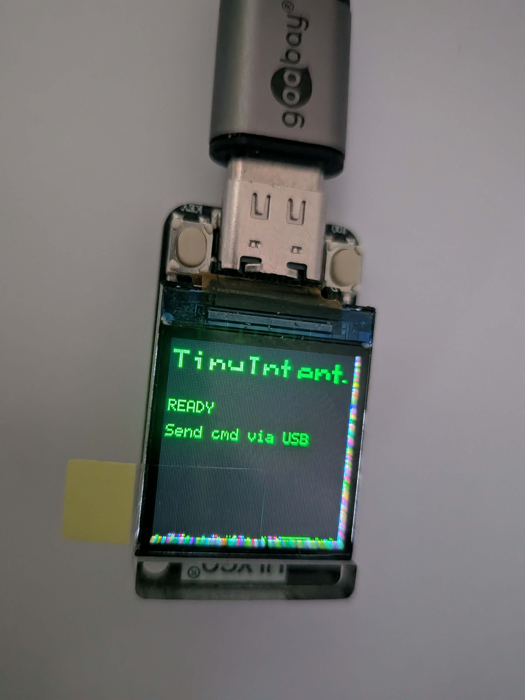
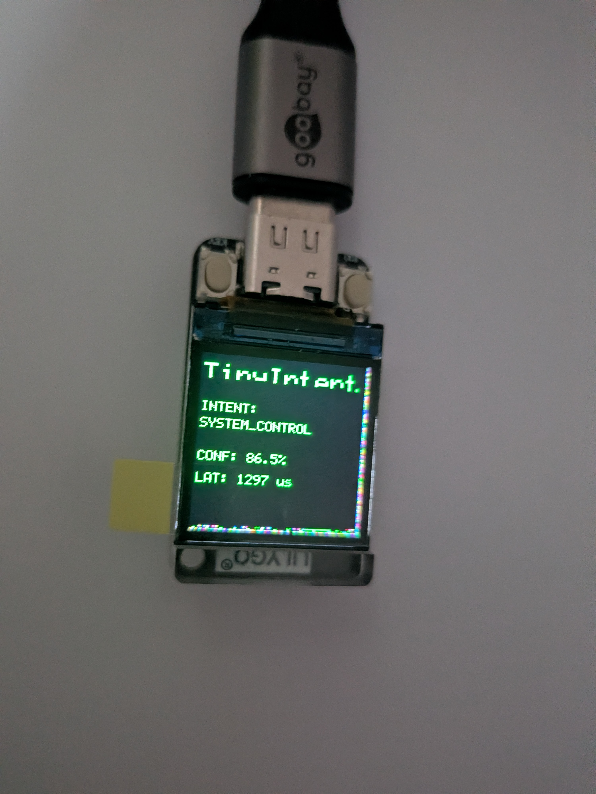
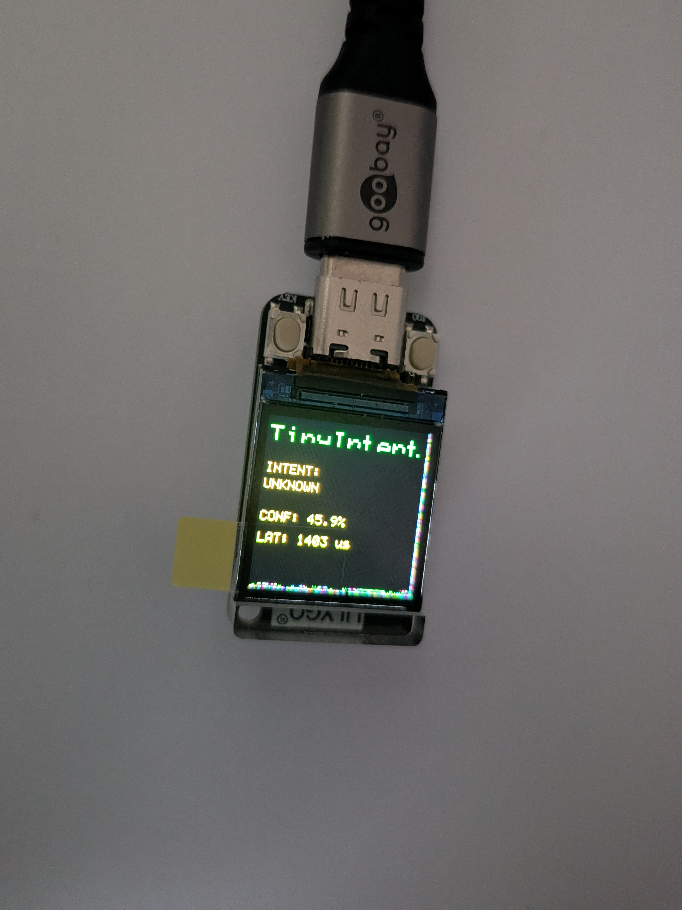
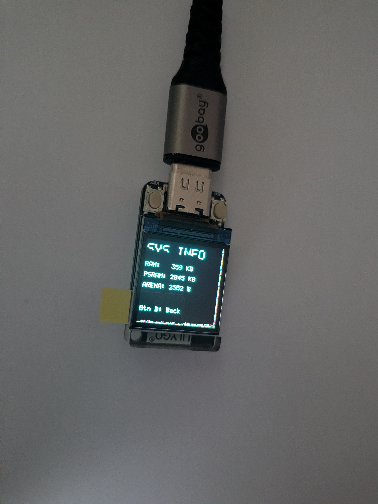

# TinyIntent

## Overview

TinyIntent is an offline intent classification system designed to explore Edge AI on resource-constrained embedded devices. It classifies textual commands locally on an ESP32-S3 and aims to reject commands that fall outside its supported intents.

In later versions, TinyIntent will explore lightweight on-device personalisation, allowing the system to adapt to user corrections without retraining the complete neural network.

## Demo

| Ready | Intent (`SYSTEM_CONTROL`) | OOD (`UNKNOWN`) | System Info |
| :---: | :---: | :---: | :---: |
|  |  |  |  |

## Motivation

Running intent classification locally can reduce inference latency, preserve data privacy, and allow the system to continue operating without an internet connection.

These advantages come with significant constraints compared with cloud-based inference. The ESP32-S3 provides limited memory, storage, and computational resources, requiring careful consideration of model size, inference latency, memory usage, and accuracy.

TinyIntent uses these constraints as part of the engineering challenge rather than treating them only as limitations.

## Hardware

- LILYGO T-QT Pro
- ESP32-S3 MCU
- No external sensors or peripherals required

Hardware resources such as available flash, RAM, and PSRAM will be measured on the target device during platform bring-up rather than assumed from specifications.

## Current Status

**Current version:** v1.0.0 - Offline Edge AI Intent Classifier

TinyIntent runs end-to-end offline intent classification on the ESP32-S3 across 5 supported intents (`DIAGNOSTICS`, `HELP`, `NETWORK_CONTROL`, `SYSTEM_CONTROL`, `SYSTEM_STATUS`) and rejects unsupported commands as `UNKNOWN`.

Implemented functionality:

- Component-based ESP-IDF 5.5 C++ firmware (`application`, `preprocessing`, `inference`, `serial_input`, `display`, `buttons`, `diagnostics`)
- Zero-heap ASCII tokenizer and `constexpr` Flash vocabulary (`117` training words) with Python golden-vector parity
- Embedded TensorFlow Lite Micro (`esp-tflite-micro`) inference using `tinyintent_dynamic_tflm.tflite`
- Non-blocking USB Serial/JTAG command interface
- GC9107 128x128 TFT UI with 5x7 bitmap font and `1,024` B strip-buffer clearing
- Confidence + OOV-ratio `UNKNOWN` rejection (`p1 < 0.50` or `oov_ratio >= 0.80`)

Measured on ESP32-S3 (controlled 120-example benchmark):

- **Model size (Flash):** `6,576` B (`tinyintent_dynamic_tflm.tflite`)
- **Tensor arena:** `2,552` B (`4,096` B reserved, `0` B PSRAM used)
- **End-to-end latency:** `~1.2–1.5 ms` (preprocessing + inference)
- **Free internal RAM:** `368,795` B
- **Evaluation:** `10/10` test accuracy, `10/10` `unknown.json` OOD rejection (`max p1 = 0.465`)

Application states:

```text
READY (Intent / Confidence / Latency)
  |  Button A
  v
SYSTEM_INFO (RAM / PSRAM / Tensor Arena)
  |  Button B
  v
READY
```

## Roadmap

| Version | Milestone |
|---|---|
| v0.1 | Embedded platform bring-up |
| v0.2 | Dataset and classical ML baseline |
| v0.3 | Tiny neural intent classifier |
| v0.4 | First embedded inference |
| v0.5 | INT8 quantisation and PC/MCU inference parity |
| v0.6 | Unknown / out-of-distribution command rejection |
| v0.7 | On-device personalisation |
| v0.8 | Persistence and robustness |
| v0.9 | Embedded optimisation and benchmarking |
| v1.0 | Portfolio-ready release |

## Running From Scratch

### Prerequisites
- **ESP-IDF 5.5.x** (targeting `esp32s3`)
- **Python 3.10+**
- **LILYGO T-QT Pro** connected via a data-capable USB-C cable

### 1. ML Training & Model Export
From `tinyintent-esp32/`, set up a Python environment and generate the vocabulary header and TFLM model:

```bash
pip install -r ml/requirements.txt

# Validate dataset splits (80 train / 20 val / 10 test / 10 unknown)
python ml/dataset_stats.py

# Generate vocabulary, golden vectors, and baseline model
python ml/train_neural.py
python ml/export_tflm.py
python ml/export_vocabulary.py

# Train label-smoothed OOD model (ls=0.1) and export tinyintent_dynamic_tflm.tflite
python ml/experiment_ood.py

# Optional: verify OOD separation on the exported TFLM model
python ml/ood_analysis.py
```

### 2. Build, Flash & Monitor Firmware
`sdkconfig` already enables PSRAM and `USB Serial/JTAG` console I/O. From `tinyintent-esp32/`:

```bash
idf.py set-target esp32s3
idf.py build
idf.py flash monitor
```

### 3. Usage
- Type a command in the serial monitor (e.g., `restart the system`, `enable wifi`, `what is the weather today`) and press **Enter** to see the predicted intent, confidence, and latency on both serial and the TFT screen.
- Press **Button A** to view `SYSTEM_INFO` (RAM, PSRAM, Arena); press **Button B** to return to `READY`.

### Example Serial Output

```text
I (1038) Application: Internal RAM free: 368795 bytes
I (1038) Application: PSRAM free: 2095000 bytes
I (1058) inference: Used Arena Bytes: 2552
I (1068) Application: Post-inference Internal RAM free: 368399 bytes
I (1068) Application: Post-inference PSRAM free: 2095000 bytes
W (16978) Application: Command "what is the weather today" -> UNKNOWN (raw=SYSTEM_STATUS, conf=0.459, oov=0.40, latency=1365 us)
I (402118) Application: Command "help" -> HELP (id=1, conf=0.924, oov=0.00, latency=1296 us)
I (410348) Application: Command "help me" -> HELP (id=1, conf=0.952, oov=0.00, latency=1335 us)
I (418488) Application: Command "flash the system" -> SYSTEM_CONTROL (id=3, conf=0.523, oov=0.00, latency=1325 us)
I (428728) Application: Command "improve flash memory" -> DIAGNOSTICS (id=0, conf=0.678, oov=0.33, latency=1372 us)
```

## License

License selection is pending.

